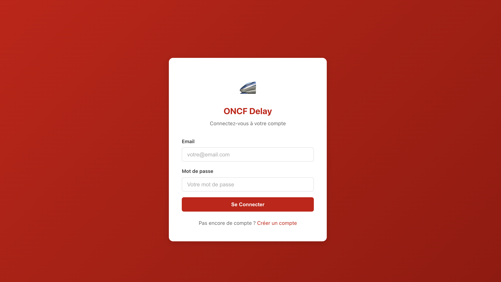
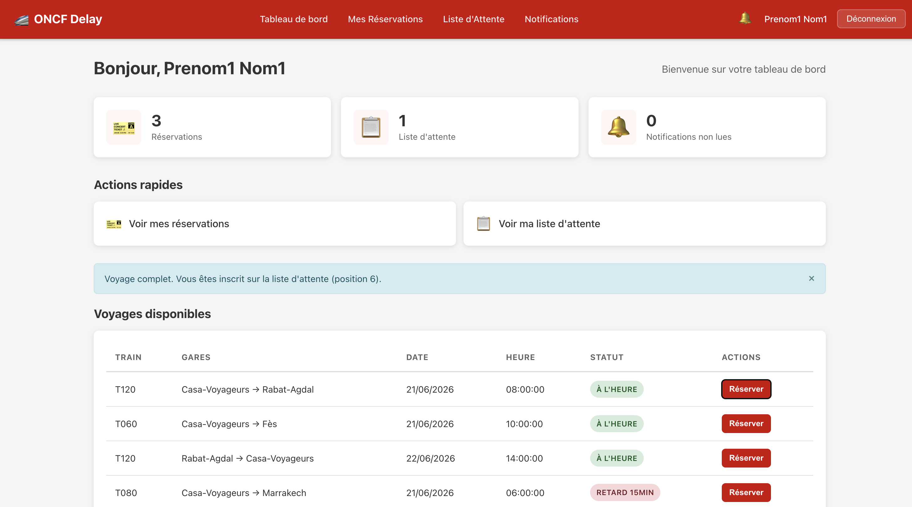
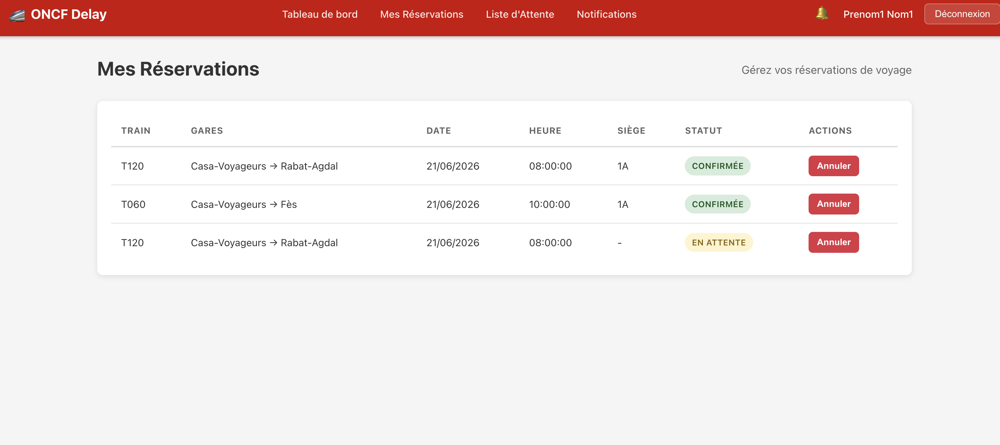
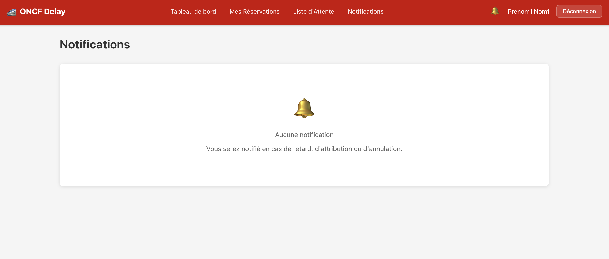
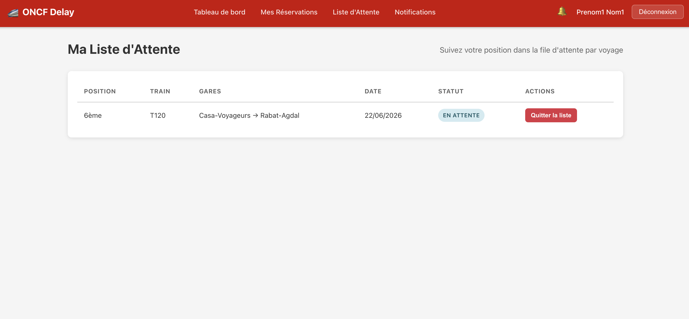
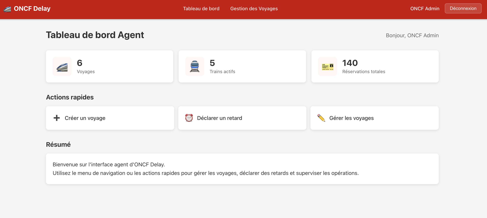
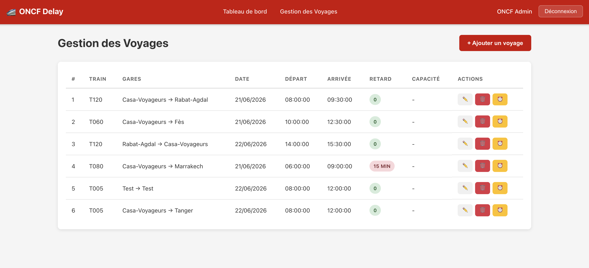
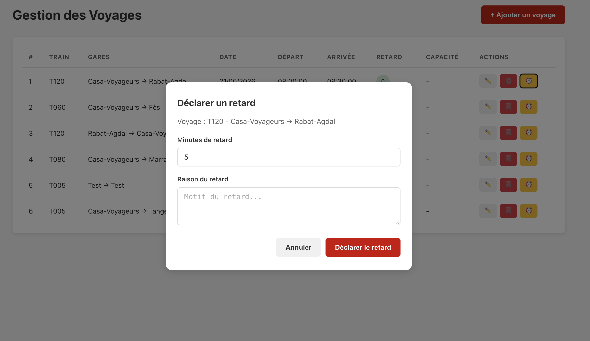

<div align="center">

# 🚄 ONCF Delay

### Train reservations, fair waiting lists, and delay notifications

An academic full-stack application inspired by railway travel in Morocco.


[Overview](#the-problem) · [Screenshots](#interface-gallery) · [Run locally](#run-locally) · [Architecture](#architecture) · [API](#api-overview)

</div>

## The problem

When a train is full, passengers need a clear way to wait for a seat. When a train is delayed, reservation holders need to know what changed. ONCF Delay brings reservations, waiting-list management, and passenger notifications into one application with separate traveler and agent interfaces.

Built as a **third-year final project in Computer Engineering and Networks at EMSI, 2025–2026**, by **Reda Sbai and Jarefa Walid**, supervised by **Pr. Sraidi Khalid**.

This is an independent educational prototype. It is not an official ONCF service, does not connect to live ONCF operations, and does not process payments.

## Features

| Traveler workspace | Agent workspace |
|---|---|
| Create an account and sign in | Sign in to a dedicated agent dashboard |
| Browse available journeys and seat availability | Create, update, and delete journeys |
| Select a seat and reserve a ticket | Create trains and set their capacity |
| View and cancel personal reservations | Declare a delay with its duration and reason |
| Join a journey's waiting list when it is full | Trigger notifications for affected reservation holders |
| Receive seat-allocation and delay notifications | Monitor journeys and train states |

### Fair seat reassignment

Each journey has its own waiting list. When a confirmed reservation is canceled, the application frees the seat and selects the earliest pending request by its request timestamp. The selected passenger receives a confirmed reservation and an allocation notification.

### Observer-based delay notifications

`Train` implements `TrainDelaySubject`; `Voyageur` implements the observer behavior. Declaring a delay updates the train and its journeys, notifies subscribed reservation holders, and persists their notifications. The React navigation bar polls notifications every **10 seconds**; this version does not use WebSockets, SMS, or email delivery.

## Interface gallery

Screenshots below are extracted from the team's project report. They document the reported interface and its demonstration data; they are not screenshots of a live ONCF system.

### Authentication



### Traveler dashboard



### Reservations and notifications





### Waiting list



### Agent dashboard and journey management





### Delay declaration



## Architecture

The runnable application consists of a React client, one Spring Boot REST backend, and a local SQLite database. The backend uses controllers, services, repositories, and JPA entities. This checkout is a single backend application rather than independently deployed microservices.

| Layer | Technologies and responsibility |
|---|---|
| Frontend | React 18, React Router 6, Axios, CSS; French-language UI |
| REST backend | Java 17, Spring Boot 3.2, Spring MVC |
| Authentication | Spring Security, BCrypt password hashing, signed JWTs |
| Persistence | Spring Data JPA, Hibernate community SQLite dialect, SQLite |
| Business logic | Reservations, seat availability, FIFO allocation, Observer notifications |

Main entities: `Voyageur`, `Agent`, `Train`, `Voyage`, `Place`, `Reservation`, `ListeAttente`, and `Notification`.

## Repository layout

| Path | Contents |
|---|---|
| [`oncf-backend/`](oncf-backend/) | Runnable Spring Boot API and Maven configuration |
| [`oncf-frontend/`](oncf-frontend/) | React application for travelers and agents |
| [`docs/screenshots/`](docs/screenshots/) | Interface images extracted from the project report |
| [`seed_data.py`](seed_data.py) | Optional reset script for a disposable demonstration database |
| [`requirements-demo.txt`](requirements-demo.txt) | Python dependency for the optional seed script |
| [`prototypes/initial-ui/`](prototypes/initial-ui/) | Earlier Vite/TypeScript frontend preserved from the original repository; separate from the runnable full-stack app |

## Run locally

### Prerequisites

- JDK **17** and Maven **3.9+**.
- Node.js and npm compatible with `react-scripts` 5. The frontend uses Create React App.
- Python 3 only if you want the optional demonstration dataset.
- Free local ports **8080** for the backend and **3000** for the frontend.

### 1. Clone the repository

```bash
git clone https://github.com/redasbai05/ONCFDELAY.git
cd ONCFDELAY
```

### 2. Start the backend

Generate a fresh signing key and export it in the same terminal that starts the backend:

```bash
export JWT_SECRET="$(openssl rand -hex 32)"
cd oncf-backend
mvn spring-boot:run
```

The API runs at `http://localhost:8080/api`. Hibernate initializes the SQLite schema in `oncf-backend/oncf.db` when started from this directory. Local databases are ignored by Git.

`.env.example` documents the variable; Spring Boot does not automatically read that file. Set `JWT_SECRET` in your terminal or IDE run configuration. Use the same secret across restarts if existing tokens should remain valid. Tokens expire after 24 hours by default.

On a fresh database, the application creates a **local demonstration agent**:

| Role | Email | Password |
|---|---|---|
| Agent | `agent@oncf.ma` | `admin123` |
| Traveler | Register through the UI | Your chosen local password |

The agent account and password are development defaults embedded in the existing seed code. Change or remove them before any deployment. Run this prototype locally with fictional data.

### 3. Start the frontend

In a second terminal, from the repository root:

```bash
cd oncf-frontend
npm ci
npm start
```

Open **http://localhost:3000**. The Axios client currently targets `http://localhost:8080/api`; update [`src/api/axios.js`](oncf-frontend/src/api/axios.js) if you change the backend address.

### 4. Add demonstration journeys

Either sign in as the agent and create trains/journeys, or use the optional seed script:

1. Start the backend once so its schema and agent account are created.
2. Stop the backend before modifying SQLite.
3. From the repository root, run:

```bash
python3 -m venv .venv
source .venv/bin/activate
python3 -m pip install -r requirements-demo.txt
python3 seed_data.py --reset-demo-data
```

**The script replaces existing journey, traveler, reservation, waiting-list, and notification records. Use it only with a disposable local demo database.** `--db /absolute/path/to/oncf.db` selects a different initialized database.

It creates four journeys and 125 fictional travelers, including a full 120-seat journey with five waiting-list entries. Traveler accounts range from `user001@example.com` to `user125@example.com`, with the demonstration password `password123`. Restart the backend afterward.

## Try the main workflows

1. **Reservation:** create a traveler account, browse journeys, select an available seat, and inspect “Mes Réservations.”
2. **Waiting list:** with the optional seed data, sign in as a waiting traveler such as `user121@example.com`. Cancel a reservation as an occupied-seat holder such as `user001@example.com`, then return to the waiting traveler's reservations and notifications to inspect allocation.
3. **Delay:** sign in as the agent, declare a delay for a journey, then sign in as one of its reservation holders and inspect notifications. The bell refreshes every 10 seconds; reopen the notifications page to refresh its full list.

## API overview

All routes below are relative to `http://localhost:8080/api`. Authenticated requests use `Authorization: Bearer <token>`.

| Method | Endpoint | Purpose |
|---|---|---|
| POST | `/auth/register` | Register a traveler |
| POST | `/auth/login` | Authenticate a traveler or agent |
| GET | `/voyageur/voyages` | List journeys |
| GET | `/voyageur/voyages/{id}/places` | View a journey's seats |
| POST | `/voyageur/voyages/{id}/reserver` | Choose a seat or enter the waiting list |
| POST | `/voyageur/reservations` | Reserve a selected seat |
| GET / DELETE | `/voyageur/reservations` / `/voyageur/reservations/{id}` | List or cancel reservations |
| GET / DELETE | `/voyageur/waiting-list` / `/voyageur/waiting-list/{id}` | Inspect or leave waiting lists |
| GET | `/voyageur/notifications` | Read passenger notifications |
| PUT | `/voyageur/notifications/{id}/read` | Mark a notification as read |
| GET / POST | `/agent/voyages` | List or create journeys |
| PUT / DELETE | `/agent/voyages/{id}` | Edit or delete a journey |
| GET / POST | `/agent/trains` | List or create trains |
| POST | `/agent/voyages/{id}/delay` | Declare a delay for the journey's train |

Agent routes require the `AGENT` role. A delay is applied at train level and affects journeys associated with that train.

## Build and current limitations

```bash
# Backend compilation
mvn -f oncf-backend/pom.xml compile

# Backend executable package
mvn -f oncf-backend/pom.xml package

# Frontend production bundle
npm --prefix oncf-frontend run build
```

This repository is an academic prototype. Further work includes automated integration tests, stronger validation and error handling, ownership checks on ID-based cancellation/read operations, concurrency protection against double booking, and production authentication/deployment configuration. The frontend stores its token in local storage. Do not use real passenger data or expose the development defaults publicly.

Potential next steps include server-pushed notifications, reliable waiting-list position updates, and deployment automation. These are future improvements, not features claimed by this checkout.

## Authors and acknowledgments

- **Reda Sbai** — [@redasbai05](https://github.com/redasbai05)
- **Jarefa Walid** — project co-author
- **Pr. Sraidi Khalid** — academic supervisor
- **EMSI, Agdal 2 – Rabat** — Computer Engineering and Networks, 2025–2026

Project context and interface images are based on the team's supplied final-year project report. The initial frontend prototype remains available in `prototypes/initial-ui/` and in Git history.
